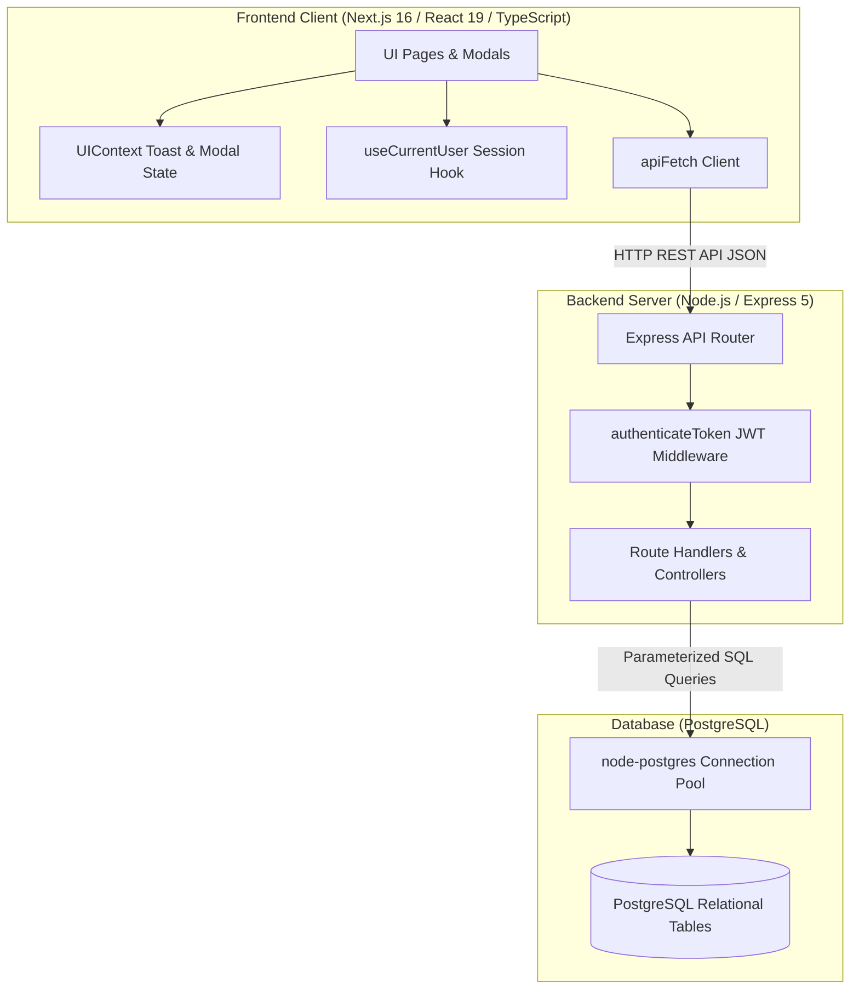

# Education ERP System

A full-stack College Management Information System (ERP) designed to streamline academic administration, student records, faculty directories, curriculum planning, examination schedules, and fee collections.

Built with **Next.js (App Router, React 19, TypeScript)** on the frontend, **Node.js with Express 5** on the backend, and **PostgreSQL** for relational data persistence.

---

## Table of Contents

- [Overview & Objectives](#overview--objectives)
- [Key Features](#key-features)
- [Technology Stack](#technology-stack)
- [System Architecture](#system-architecture)
- [Repository Structure](#repository-structure)
- [Prerequisites](#prerequisites)
- [Step-by-Step Local Setup (Windows)](#step-by-step-local-setup-windows)
  - [1. Clone Repository](#1-clone-repository)
  - [2. PostgreSQL Database Setup](#2-postgresql-database-setup)
  - [3. Backend Configuration & Startup](#3-backend-configuration--startup)
  - [4. Frontend Configuration & Startup](#4-frontend-configuration--startup)
- [Local URLs & Ports](#local-urls--ports)
- [Verification & Troubleshooting](#verification--troubleshooting)
- [Security Notes](#security-notes)
- [Project Status & Future Enhancements](#project-status--future-enhancements)
- [Author](#author)

---

## Overview & Objectives

### Problem Statement
Educational institutions often manage student enrollments, faculty profiles, curriculum batches, examination schedules, and fee records across separate spreadsheets or offline systems. This can cause data duplication, delayed tracking of tuition receivables, and administrative overhead.

### Project Objectives
- **Centralized Administration:** Provide a unified web interface for administrators to manage institutional records with full CRUD operations.
- **Relational Integrity:** Maintain relational data structures across students, faculty, courses, exams, and fee transactions using PostgreSQL.
- **Financial Tracking:** Offer a consolidated dashboard view of fee collections and pending balances calculated from stored records.
- **Secure Authentication:** Implement stateless JSON Web Token (JWT) authorization and salted bcrypt password hashing for administrative access.
- **Type Safety & Maintainability:** Use TypeScript interfaces and modular React 19 components to ensure predictable client-side state.

---

## Key Features

### 1. Authentication & Session Management
- **Admin Authentication:** Secure administrator sign-in portal (`/login`) with credential validation against PostgreSQL.
- **Password Security:** Salted password hashing using `bcrypt` (10 rounds) with compatibility for existing hashed records.
- **Token-Based Authorization:** Stateless JWT tokens signed with `JWT_SECRET` attached to client API requests.
- **Protected Routes:** Backend Express middleware (`authenticateToken`) verifying Bearer tokens on protected API endpoints.
- **Client Session Sync:** Persistent session tracking via `localStorage` with `useSyncExternalStore` for reactive cross-component state.

### 2. Administration Dashboard
- **Summary Metrics:** Overview counters displaying total counts for students, teachers, courses, scheduled exams, total collected fees, and pending dues.
- **Database Aggregation:** Metric calculations retrieved via SQL aggregation (`COUNT`, `SUM`, `COALESCE`) on page load.
- **Fee Collection Progress:** Visual bar representing the percentage of fees collected relative to total invoiced amounts.
- **Quick Links:** Direct navigation shortcuts to individual administrative modules.

### 3. Student Records Management
- **Full CRUD:** Register new students, edit existing profiles, search records, and delete entries.
- **Tracked Data:** Full Name, Email Address, Mobile Number, and Enrolled Course.
- **Search & Filter:** Client-side search across student names, emails, phone numbers, and course names.
- **Deletion Confirmation:** Modal prompt confirming deletion before removing student records.

### 4. Faculty Directory
- **Full CRUD:** Register faculty members, update contact details and subject assignments, view directory, and delete entries.
- **Tracked Data:** Full Name, Email Address, Mobile Number, and Assigned Subject.
- **Search & Filter:** Instant search filter across faculty names, subjects, and contact information.

### 5. Academic Curriculum & Courses
- **Full CRUD:** Create new course offerings, edit durations and fee structures, view active programs, and remove obsolete courses.
- **Tracked Data:** Course Name, Course Code, Duration (e.g., "4 Years"), and Tuition Fees.
- **Search:** Filter courses by name and course code.

### 6. Examination Scheduling
- **Full CRUD:** Schedule exam sessions, associate exams with courses, edit dates and marks, and delete schedules.
- **Tracked Data:** Exam Title, Associated Course, Exam Date, and Maximum Total Marks.
- **Search:** Search exams by title or course name.

### 7. Fee Collection & Ledger
- **Full CRUD:** Record fee payments, adjust installment amounts, track pending balances, and remove ledger records.
- **Tracked Data:** Student Name, Roll Number, Enrolled Course, Total Fees, Paid Amount, Remaining Balance, Payment Date, Payment Mode (Cash, Online, Cheque, Bank Transfer), and Status (Paid, Pending, Partial).
- **Status Indicators:** Color-coded badges for payment status (`Paid`, `Pending`, `Partial`).

---

## Technology Stack

| Layer | Technology | Version | Purpose |
| :--- | :--- | :--- | :--- |
| **Frontend Framework** | [Next.js](https://nextjs.org/) | `16.2.11` | React App Router framework with Turbopack bundler |
| **UI Library** | [React](https://react.dev/) | `19.2.4` | Component architecture and UI rendering |
| **Frontend Language** | [TypeScript](https://www.typescriptlang.org/) | `^5` | Static type safety and data models |
| **Styling** | [Tailwind CSS](https://tailwindcss.com/) | `^4` | Responsive styling and custom design system |
| **Backend Runtime** | [Node.js](https://nodejs.org/) | `v20.9.0+` LTS | Asynchronous JavaScript runtime (Next.js 16 requirement) |
| **Backend Framework** | [Express.js](https://expressjs.com/) | `^5.2.1` | REST API routing and middleware |
| **Database** | [PostgreSQL](https://www.postgresql.org/) | `v14+` | Relational SQL database |
| **Database Driver** | [node-postgres (`pg`)](https://node-postgres.com/) | `^8.22.0` | Connection pooling and parameterized SQL queries |
| **Authentication** | [jsonwebtoken](https://github.com/auth0/node-jsonwebtoken) | `^9.0.3` | JWT generation and Bearer token verification |
| **Password Hashing** | [bcrypt](https://github.com/kelektiv/node.bcrypt.js) | `^6.0.0` | Password hashing with cryptographic salts |
| **CORS** | [cors](https://github.com/expressjs/cors) | `^2.8.6` | Cross-Origin Resource Sharing handling |
| **Environment Management** | [dotenv](https://github.com/motdotla/dotenv) | `^17.4.2` | Loading environment variables from `.env` |
| **Development Utilities** | [Nodemon](https://nodemon.io/) / ESLint | Latest | Backend auto-reload and frontend code linting |

---

## System Architecture

The application is structured as a 3-tier client-server architecture:



---

## Repository Structure

```text
education-erp/
├── backend/
│   ├── config/
│   │   └── db.js                 # PostgreSQL connection pool configuration
│   ├── controllers/
│   │   └── authController.js     # Admin login & current user profile verification
│   ├── middleware/
│   │   └── authMiddleware.js     # JWT verification middleware (authenticateToken)
│   ├── models/
│   │   └── userModel.js          # User query helpers
│   ├── routes/
│   │   ├── authRoutes.js         # Authentication endpoints (/api/auth)
│   │   ├── coursesRoutes.js      # Course management endpoints (/api/courses)
│   │   ├── dashboardRoutes.js    # Metric aggregation endpoint (/api/dashboard)
│   │   ├── examsRoutes.js        # Exam schedule endpoints (/api/exams)
│   │   ├── feesRoutes.js         # Fee management endpoints (/api/fees)
│   │   ├── studentsRoutes.js     # Student records endpoints (/api/students)
│   │   └── teachersRoutes.js     # Faculty records endpoints (/api/teachers)
│   ├── .env.example              # Template for backend environment variables
│   ├── .gitignore                # Backend-specific ignore rules
│   ├── hashPassword.js           # CLI password hashing utility (bcrypt)
│   ├── package.json              # Backend dependencies & npm scripts
│   └── server.js                 # Express server entry point & error handlers
├── database/
│   ├── schema.sql                # Complete PostgreSQL DDL schema with indexes
│   └── users.sql                 # Baseline users table definition
├── frontend/
│   ├── app/
│   │   ├── components/           # Reusable forms, AppLayout, and icons
│   │   ├── courses/              # Course programs page
│   │   ├── dashboard/            # Executive dashboard page
│   │   ├── exams/                # Examination schedules page
│   │   ├── fees/                 # Fee collection ledger page
│   │   ├── login/                # Admin login portal page
│   │   ├── students/             # Student records management page
│   │   ├── teachers/             # Faculty directory page
│   │   ├── globals.css           # Styling tokens, layout styles, and animations
│   │   ├── layout.tsx            # Root application layout with UIProvider
│   │   └── page.tsx              # Root redirect handler
│   ├── lib/
│   │   ├── api.ts                # Centralized API fetcher & session helpers
│   │   ├── UIContext.tsx         # Toast notifications & modal dialog context
│   │   └── useCurrentUser.ts     # Session state synchronization hook
│   ├── public/                   # Static SVG assets
│   ├── .gitignore                # Frontend-specific ignore rules
│   ├── eslint.config.mjs         # ESLint 9 configuration
│   ├── next.config.ts            # Next.js configuration
│   ├── package.json              # Frontend dependencies & npm scripts
│   ├── postcss.config.mjs        # PostCSS configuration
│   └── tsconfig.json             # TypeScript configuration
├── .gitignore                    # Root ignore rules
└── README.md                     # Project documentation
```

---

## Prerequisites

Before setting up the project locally on Windows, ensure the following are installed:

1. **Node.js:** `v20.9.0` or higher (LTS `v20.x` or `v22.x` recommended; Next.js 16 requires Node.js `>=20.9.0`) ([Download Node.js](https://nodejs.org/))
2. **npm:** `v10.x` or higher (installed with Node.js)
3. **PostgreSQL:** `v14.x` or higher ([Download PostgreSQL for Windows](https://www.postgresql.org/download/windows/))
4. **Git:** ([Download Git](https://git-scm.com/))

Verify tool installations in PowerShell:

```powershell
node -v
npm -v
psql --version
```

---

## Step-by-Step Local Setup (Windows)

Follow these steps sequentially to set up and run the system locally.

### 1. Clone Repository

Open PowerShell or Command Prompt:

```powershell
git clone https://github.com/akshayshendurkar55-dot/education-erp-system.git
cd education-erp-system
```

---

### 2. PostgreSQL Database Setup

1. Open PowerShell or Command Prompt and connect to PostgreSQL:

```powershell
psql -U postgres
```

2. Create the database:

```sql
CREATE DATABASE erp_system;
\q
```

3. Import the database schema from the project root (`education-erp-system`):

```powershell
psql -U postgres -d erp_system -f database/schema.sql
```

---

### 3. Backend Configuration & Startup

1. From the project root, navigate to the `backend` directory:

```powershell
cd backend
```

2. Install backend dependencies:

```powershell
npm install
```

3. Create your local `.env` file from `.env.example`:

```powershell
# PowerShell
Copy-Item .env.example .env

# Command Prompt
copy .env.example .env
```

4. Open `backend/.env` in your editor and configure your database credentials and secret key:

```env
PORT=5000

DB_HOST=localhost
DB_PORT=5432
DB_NAME=erp_system
DB_USER=postgres
DB_PASSWORD=your_actual_postgres_password

# Set a secure secret key for signing JWTs
JWT_SECRET=your_jwt_secret_key_here
```

5. *(Optional)* Seed an Initial Admin Account:

While inside the `backend` directory, generate a password hash:

```powershell
node hashPassword.js your_admin_password
```

Connect to PostgreSQL using `psql` to insert the administrator record (`database/schema.sql` defines a `UNIQUE` constraint on `username`, and `role` must be `'ADMIN'`):

```powershell
psql -U postgres -d erp_system
```

```sql
INSERT INTO users (username, password, role)
VALUES ('admin', 'GENERATED_HASH_STRING_HERE', 'ADMIN')
ON CONFLICT (username) DO NOTHING;
\q
```

6. Start the backend server:

```powershell
# Development mode with live reload (nodemon server.js)
npm run dev

# Or standard execution (node server.js)
npm start
```

*Expected console output:*

```text
Server running on Port 5000
PostgreSQL Connected Successfully
```

---

### 4. Frontend Configuration & Startup

1. Open a **new, separate terminal window**.

2. Navigate to the `frontend` directory:

```powershell
# From the project root:
cd frontend

# (If your terminal is currently inside the backend folder, run: cd ..\frontend)
```

3. Install frontend dependencies:

```powershell
npm install
```

4. Start the Next.js development server:

```powershell
npm run dev
```

*The frontend starts via Turbopack on `http://localhost:3000`.*

---

## Local URLs & Ports

| Service | Local Address | Description / Route |
| :--- | :--- | :--- |
| **Frontend Web App** | `http://localhost:3000` | Application root (redirects unauthenticated users to `/login`) |
| **Admin Login Portal** | `http://localhost:3000/login` | Administrator sign-in page |
| **Dashboard** | `http://localhost:3000/dashboard` | Main metrics overview and module shortcuts |
| **Students Module** | `http://localhost:3000/students` | Student records table, search, and registration modal |
| **Teachers Module** | `http://localhost:3000/teachers` | Faculty directory and subject assignments |
| **Courses Module** | `http://localhost:3000/courses` | Academic programs and fee structures |
| **Exams Module** | `http://localhost:3000/exams` | Scheduled exams timetable and total marks |
| **Fees Module** | `http://localhost:3000/fees` | Fee payment ledger and collection statuses |
| **Backend Health Check** | `http://localhost:5000` | Returns `{ status: "online", service: "Education ERP Backend API" }` |
| **Backend API Root** | `http://localhost:5000/api` | Base path for REST API endpoints |

---

## Verification & Troubleshooting

### 1. Verification Steps

- **Backend Health:** Open `http://localhost:5000` in your browser. It should return a JSON status object.
- **Frontend Build & Lint:** Run in the `frontend` directory:

```powershell
# Check TypeScript compilation
npx tsc --noEmit
# Run linter
npm run lint
# Validate production build
npm run build
```

- **Backend Syntax Check:** Run in the `backend` directory:

```powershell
node --check server.js
```

### 2. Common Troubleshooting

| Problem | Likely Cause | Solution |
| :--- | :--- | :--- |
| **`password authentication failed for user "postgres"`** | Incorrect database password in `backend/.env` | Update `DB_PASSWORD` in `backend/.env` to match your local PostgreSQL password. |
| **`connect ECONNREFUSED 127.0.0.1:5432`** | PostgreSQL service is stopped | Open Windows Services (`services.msc`), find `postgresql-x64-<version>`, and click **Start**. |
| **`EADDRINUSE: address already in use :::5000`** | Another process is using port 5000 | Terminate the occupying process via Task Manager or update `PORT` in `backend/.env` and update API base URL. |
| **Immediately redirected to `/login`** | Missing or expired JWT session | Verify backend is running and you have created an admin account; sign in at `http://localhost:3000/login`. |

---

## Security Notes

- **Environment Isolation:** Never commit real `.env` files, production database passwords, or JWT secrets to Git. The repository tracks only `.env.example` templates.
- **Parameterized Queries:** Backend database interactions use parameterized SQL placeholders (`$1`, `$2`) with `pg.Pool` to prevent SQL injection.
- **Password Hashing:** Passwords are stored as salted `bcrypt` hashes, never as plaintext.
- **Token Handling:** JWTs are stored client-side in `localStorage` and sent via `Authorization: Bearer <token>` headers to protected endpoints.

---

## Project Status & Future Enhancements

### Current Status
- ✅ Full-stack local development environment operational.
- ✅ Admin authentication with bcrypt hashing and JWT middleware protection.
- ✅ Full CRUD operations implemented for Students, Teachers, Courses, Exams, and Fees.
- ✅ Administration Dashboard with PostgreSQL aggregation metrics.
- ✅ Strict TypeScript interfaces and modular component structure.

### Future Enhancements
- [ ] **Multi-Role Portals:** Distinct portals and dashboards for Faculty and Students.
- [ ] **PDF Receipt Generation:** Automated generation and download of tuition fee receipts.
- [ ] **Attendance Tracking:** Daily attendance logging for students and faculty.
- [ ] **Automated Alerts:** Email or SMS notifications for fee dues and examination notices.
- [ ] **Containerization & CI/CD:** Dockerfile configuration and GitHub Actions workflows for automated test pipelines.

---

## Author

- **Author:** Laxmikant Shendurkar ([@akshayshendurkar55-dot](https://github.com/akshayshendurkar55-dot))
- **Program:** B.Tech Computer Science & Engineering (CSE)
- **Repository:** [https://github.com/akshayshendurkar55-dot/education-erp-system](https://github.com/akshayshendurkar55-dot/education-erp-system)